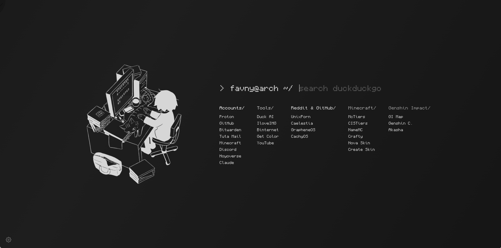

<div align="center">

# Startpage </

**A personal monochrome browser startpage with a terminal-style search prompt, animated art, and customizable link columns.**

[](https://developer.mozilla.org/en-US/docs/Web/HTML)
[](#features)
[](https://pages.github.com/)

<br>



[**Open the live startpage →**](https://favnywastaken.github.io)

</div>

## ✨ Features

- Terminal-style prompt with built-in DuckDuckGo search — press **Enter** to search; `!bangs` work
- Link columns configured in a single file
- Animated transparent illustration, replaceable in settings
- Monochrome theme with subtle leaves and a slow background shimmer
- Monocraft font
- Settings panel for editing the page (gear icon, bottom left)
- Responsive layout with `prefers-reduced-motion` support
- Plain HTML, CSS, and JavaScript — no build step or dependencies

## 📁 Project structure

```text
.
├── index.html
├── style.css
├── script.js
├── config.js
├── fonts/
│   └── Monocraft.ttf
└── img/
    └── cat.webp
```

## 🧪 Run locally

```sh
git clone https://github.com/FavnyWasTaken/FavnyWasTaken.github.io
cd FavnyWasTaken.github.io
python -m http.server 8000
```

Open [http://localhost:8000](http://localhost:8000).

> [!TIP]
> Run the server from inside the project folder. Otherwise, it may show a directory listing instead of the startpage.

## 🔤 Font

Monocraft is not included in the repository by default. Download it into `fonts/`:

```sh
curl -L -o fonts/Monocraft.ttf https://cdn.jsdelivr.net/gh/IdreesInc/Monocraft@main/dist/Monocraft-ttf/Monocraft.ttf
```

Without the font, the page falls back to the system monospace font.

## ⚙️ Configuration

Default settings live in `config.js`:

```js
window.CONFIG = {
  title: "start",
  prompt: "favny@arch ~/",
  search: "https://duckduckgo.com/?q=",
  theme: { bg: "#0d0d0d", text: "#c9c9c9", leaf: "#171717" },
  hero: { src: "img/cat.webp", w: 460 },
  sections: [ ... ],
  leaves: 26,
};
```

| Key | Description |
| --- | --- |
| `title` | Browser tab title |
| `prompt` | Text shown after `>` and before the search field |
| `search` | Search URL prefix; the query is appended to it |
| `theme` | Background, text, and leaf colors |
| `hero` | Default illustration path and width in pixels |
| `sections` | Link columns |
| `leaves` | Number of background leaves; set to `0` to remove them |

### Link sections

Each section has a title, a color, and a list of links:

```js
{
  title: "Tools",
  color: "#bdbdbd",
  links: [
    { name: "YouTube", url: "https://www.youtube.com/" },
  ],
},
```

Add, remove, or reorder objects to customize the page. CSS adds a trailing `/` to each section title.

### Search engine

Set `search` to a URL that accepts the query at the end. For example:

```js
search: "https://www.startpage.com/do/search?q="
```

### Colors

Edit `theme` and the `color` value of each section. Neutral grays work best with the monochrome look.

## 🎛️ Settings panel

Click the gear icon to open the settings panel. Press **Esc** to close it.

You can change:

- Tab title and prompt text
- Background, text, and leaf colors
- Section titles and colors
- Link names and URLs; add or remove links
- Illustration size and image

Supported illustration formats include `.gif`, `.png`, `.jpg`, and `.webp`. Use **restore cat** to restore the default illustration.

> [!NOTE]
> Settings are saved in the browser using `localStorage` and IndexedDB. They are stored per address and browser, and do not sync between devices or between `localhost` and `github.io`. Use **reset everything** at the bottom of the panel to clear them.

To make a change permanent for everyone, edit `config.js` and push the changes.

If a `config.js` change needs to override saved settings, bump the `KEY` constant at the top of `script.js`—for example, change it to `startpage.v4`.

## 🖼️ Illustration

The default `img/cat.webp` is an animated WebP with a transparent background, so it blends into different themes.

GIF supports only on/off transparency, which can leave jagged edges. WebP or PNG are better choices for transparent artwork. An image with its own background is displayed as-is.

## 🚀 Deploy

Push changes to `main`. GitHub Pages serves the repository root.

```sh
git add .
git commit -m "Update startpage"
git push
```

If the site does not appear, check **Settings → Pages** and make sure the source is set to **Deploy from a branch**, branch **`main`**, folder **`/ (root)`**.

## 🙏 Credits

- [Monocraft](https://github.com/IdreesInc/Monocraft) by IdreesInc — licensed under OFL-1.1
- Layout inspired by terminal-style startpages; written from scratch

## 📄 License

MIT. See [LICENSE](LICENSE).
